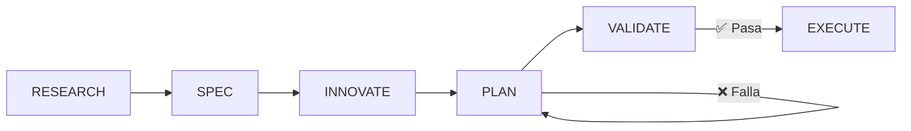

# 📋 Guía del Workflow RIPER-5

Esta carpeta contiene la estructura para los artefactos del workflow RIPER-5.

## 📁 Estructura

```
process/
├── general-plans/           # Planes globales (app-wide)
│   └── active/             # Planes activos actuales
│       └── _PLAN_<feature>.md  ← Crea aquí nuevos planes
├── features/                # Planes por feature
│   └── <feature-name>/     # Carpeta para cada feature
│       └── active/        # Planes específicos del feature
│           └── _PLAN_<sub-feature>.md
└── specs/                   # Especificaciones (opcional)
    └── _SPEC_<version>.md  ← Crea especificaciones aquí
```

## 🔄 Flujo de Trabajo RIPER-5

### **Fase 1: RESEARCH**
- **Agent**: `vc-research-agent`
- **Artefacto**: Context gathered en chat
- **Objetivo**: Entender el problema y recopilar información

### **Fase 2: SPEC** (Requerimientos)
- **Agent**: `vc-spec-agent`
- **Artefacto**: `_SPEC_<version>.md`
- **Ubicación**: `process/features/<feature>/specs/` o `process/specs/`
- **Objetivo**: Especificar qué se necesita

### **Fase 3: INNOVATE** (Decisión Técnica)
- **Agent**: `vc-innovate-agent`
- **Artefacto**: Decision summary (en chat o archivo)
- **Objetivo**: Evaluar opciones y elegir la mejor

### **Fase 4: PLAN** (Plan de Implementación) ⭐ IMPORTANTE
- **Agent**: `vc-plan-agent`
- **Artefacto**: `_PLAN_<feature>.md`
- **Ubicación**: 
  - `process/general-plans/active/_PLAN_<name>.md` (globales)
  - `process/features/<feature>/active/_PLAN_<sub>.md` (específicos)
- **Objetivo**: Detallar cómo implementar

### **Fase 5: VALIDATE** (Validación de Contrato)
- **Agent**: `vc-validate-agent`
- **Artefacto**: Validate-contract (V1-V7) dentro del plan file
- **Objetivo**: Verificar que el plan cumple requisitos
- **⚠️ OBLIGATORIO antes de ejecutar**

### **Fase 6: EXECUTE** (Implementación)
- **Agent**: `vc-execute-agent`
- **Artefacto**: Edits en source files
- **NOTA**: Solo tras validación exitosa

### **Fase 7: UPDATE PROCESS** (Cleanup)
- **Agent**: `vc-update-process-agent`
- **Objetivo**: Archivar plan, limpiar recursos

## 🚦 Phase Gates (Puntos de Control)



**Regla de oro**: Nunca saltar directamente de PLAN a EXECUTE sin pasar por VALIDATE.

## 📝 Formato de Archivos

### Especificación (_SPEC_):
```markdown
# _SPEC_<feature>.md

## Feature: <Nombre>
- **Descripción:** Qué se necesita
- **Requisitos funcionales:** [...]
- **Requisitos no funcionales:** [...]
- **Criterios de aceptación:** [...]
```

### Plan (_PLAN_):
```markdown
# _PLAN_<implementation>.md

## Fase PLAN: Implementación de <feature>

### Contexto
- Referencia a _SPEC_<feature>.md
- Decisiones técnicas

### Pasos de implementación
1. ...

### Pruebas necesarias
- ...

### Rollback plan
- ...

## VALIDATION CONTRACT
✅ Validado por vc-validate-agent
```

---

**Última actualización**: Noviembre 2026
**Version**: RIPER-5 v1.0
